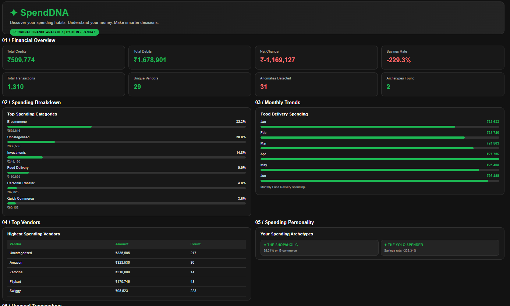

# SpendDNA – Personal Finance Analytics & Spending Personality Detection

**A Python-based personal finance analytics project that analyses synthetic transaction data to identify spending patterns, detect unusual transactions and discover spending personality types.**

## 📸 Project Output Screenshot

## 🛠️ Technology Used

- Python
- Pandas
- NumPy
- Basic HTML
- Basic CSS
- Google Colab

## 📋 Project Constraints

This project follows the specified technology and library restrictions.

### ✅ Allowed

- Python fundamentals: variables, data types, conditions, loops and functions
- Lists, tuples, sets and dictionaries
- List and dictionary comprehensions
- String operations and f-strings
- Pandas
- NumPy
- Basic HTML
- Basic CSS

### ❌ Not Allowed

- Matplotlib
- Seaborn
- Plotly
- Scikit-learn
- Regex
- `collections.Counter`
- Other libraries or tools prohibited by the project guidelines

## 📂 Repository Structure

SpendDNA/
│
├── SpendDNA.ipynb
├── rahul_transactions.csv
└── README.md

## 🚀 How to Run

1. Clone or download this GitHub repository.
2. Open [Google Colab](https://colab.research.google.com/).
3. Upload `SpendDNA.ipynb`.
4. Upload the synthetic dataset `rahul_transactions.csv`.
5. Run all notebook cells sequentially, from Day 1 to Day 7.
6. Execute the final HTML/CSS dashboard cell to view the project output.

## 📊 Project Output

SpendDNA generates:

- Financial summary and spending insights
- Category-wise spending analysis
- Monthly spending trends
- Hourly spending patterns
- Unusual transaction detection
- Spending personality archetypes
- Final HTML/CSS dashboard

**Developed by: Mayuri Nilange**

